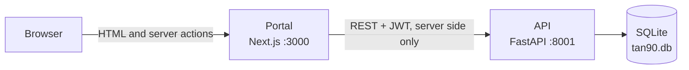
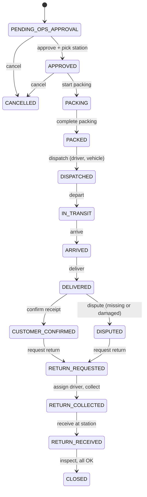
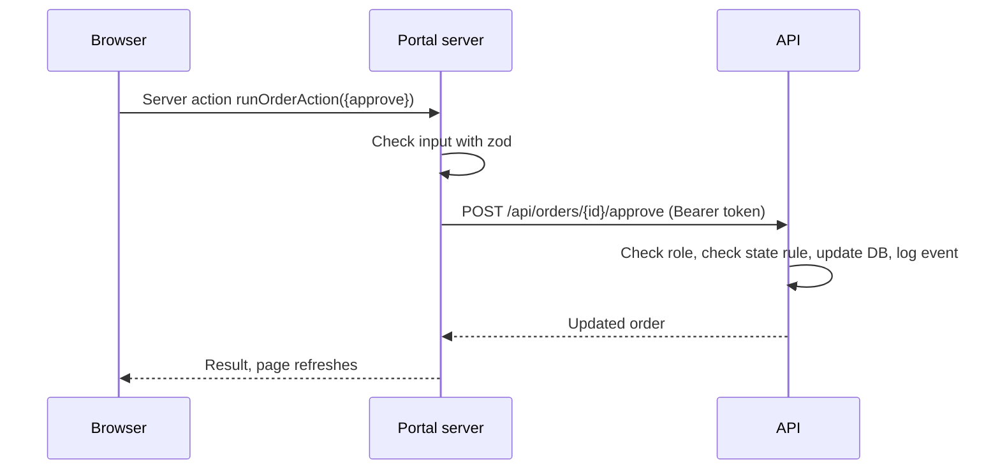

# Developer Guide

Everything a new developer needs: what the product does, how the code fits together, how to work on it, and what is done and pending.

Contents: [1. The product](#1-the-product) · [2. Architecture](#2-architecture) · [3. Set up](#3-set-up-from-zero) · [4. Code map](#4-code-map) · [5. Order lifecycle](#5-order-lifecycle) · [6. How a click becomes data](#6-how-a-click-becomes-data) · [7. Add a feature](#7-add-a-feature) · [8. Test and verify](#8-test-and-verify) · [9. Production checklist](#9-production-checklist) · [10. Status and plan](#10-status-and-plan) · [11. Troubleshooting](#11-troubleshooting)

---

## 1. The product

Tan90 rents **cooling panels** (PCM panels) to customers who ship temperature-sensitive goods such as vaccines and food. The panels are frozen at a **freezing station**, packed into reusable **containers**, delivered, used, and returned.

The portal lets the Ops team run that cycle and always know where every container is.

| Term | Meaning |
| --- | --- |
| **PCM panel / asset** | The product being rented. Each type (SKU) has a temperature setpoint, such as -24 °C |
| **Container** | A reusable box or bag that carries panels. Each has a code (`CON-000016`) and an RFID tag or barcode |
| **Freezing station (FS)** | A site that freezes panels, packs and dispatches orders. Stock is counted per station |
| **Warehouse (WH)** | A storage location that holds stock but does not pack orders |
| **Order** | A customer request for panels. It moves through a fixed lifecycle (section 5) |
| **Packing session** | The step where containers are scanned onto an order and filled with panels |
| **Movement** | One stock change: inward (stock added) or outward (stock removed). Dispatching an order records an outward Sales movement |
| **Exception** | Something wrong: an unknown scan, or a container reported missing or damaged |
| **Scan** | A barcode or RFID reader typing a code and pressing Enter. A scan can be the tag ID or the label code |

Roles in the backend: Super Admin, Operations Admin, Freezing Station Manager, Warehouse, Packing Worker, Driver, Customer, Supply Chain Manager.

---

## 2. Architecture



- The **browser never talks to the API**. The portal's server calls it. The token and credentials stay on the server.
- The portal signs in to the API as **one service account** and reuses the token. Because of this, **the portal has no login and everyone who can open it acts as Ops.** Do not expose it to the internet until real login exists (section 10).
- All business rules (state machine, stock math, scan checks) live in the **API**. The portal only shows data and sends actions.
- The database is created and filled with demo data on first start in development. In production it is never seeded.

---

## 3. Set up from zero

**Install:** Node.js 20+, Python 3.12, Git. Python 3.12 is the tested version. Python 3.15 fails because the pinned packages do not build there; 3.13 and 3.14 are untested.

```bash
git clone <repo-url> tan90 && cd tan90

# Terminal 1: API
cd backend
# Windows PowerShell
py -3.12 -m venv .venv
.\.venv\Scripts\python.exe -m pip install -r requirements-dev.txt
.\.venv\Scripts\python.exe -m uvicorn app.main:app --port 8001 --reload

# macOS/Linux
python3.12 -m venv .venv
source .venv/bin/activate
pip install -r requirements-dev.txt
uvicorn app.main:app --port 8001 --reload

# Terminal 2: Portal (from the repo root)
npm install
npm run dev
```

Open http://localhost:3000. Log-in is not needed. API docs: http://localhost:8001/docs.

**Settings:** copy `.env.example` to `.env.local` in the repo root. Both apps read this one file (it is git-ignored). Without it, safe development defaults apply. Start the API from the `backend` folder, because the SQLite path in `DATABASE_URL` is relative.

Demo data: 6 locations, 6 customers, 8 products, 60 containers and 15 orders, one in every lifecycle state. Users and their roles are in [backend/guide.txt](backend/guide.txt) (password for all: `password123`).

To reset the data: stop the API, delete `backend/tan90.db`, start it again.

---

## 4. Code map

```
backend/
  app/main.py          App start-up, CORS, router registration
  app/core/            Settings, auth checks, order and container state rules
  app/models/          Database tables (SQLAlchemy)
  app/schemas/         Request and response shapes (Pydantic)
  app/routers/         HTTP endpoints, one file per area
  app/services/        Business logic: order_flow, inventory, scan, container_view
  app/db/              Engine, session, demo data (seed.py)
  API.md               Endpoint reference
  test.py              Test of every endpoint

src/
  app/(portal)/        Pages: orders, inventory, assets, deliveries, exceptions
  features/<name>/     One folder per feature (below)
  components/ui/       Buttons, forms, dialogs, tables, badges, scan input
  components/layout/   Sidebar, header, app shell
  server/              backend.ts (API client), action.ts (server-action wrapper), logger
  config/              Validated env, navigation, site info
  lib/                 Errors, formatting, helpers
```

A feature folder holds: `queries.ts` (read data), `actions.ts` (write data, server actions), `schemas.ts` (input rules), `types.ts`, and `components/`.

| Feature | Screens |
| --- | --- |
| `orders` | Order list, new order, order page with every lifecycle step |
| `inventory` | Overview, asset inventory, movements, freezing stations |
| `containers` | Asset Management: container register, container page, tag replacement |
| `deliveries` | Driver board: load, depart, arrive, deliver, collect |
| `exceptions` | Unknown scans, missing and damaged containers, resolve |

---

## 5. Order lifecycle

The API owns these rules. An illegal step returns HTTP 409. Each step is its own endpoint; the client never sends a status.



Rules worth knowing:

- **Cancel** is allowed only before packing starts (pending or approved).
- **Packing** links containers to the order by scan. One order can use many containers, and each container records what it holds.
- **Dispatch** needs every container scanned, plus a driver and a vehicle number. It removes the stock from the station and writes a Sales movement.
- **Confirm receipt**: if any container is marked missing or damaged, the order becomes disputed and an exception is raised.
- **Inspect**: containers that pass go back to stock. Damaged or contaminated ones keep the order open.

---

## 6. How a click becomes data

Example: Ops clicks **Approve** on an order.



- Reads: a page calls a function in `features/<name>/queries.ts`, which calls `backend("/api/...")`.
- Writes: a button calls a server action built with `createAction(schema, handler)`. It returns `{ ok: true, data }` or `{ ok: false, error }`. It does not throw.
- Errors: throw `AppError(code, message)` for expected failures. The message is shown to the user. Anything else is logged and shown as a generic error.
- The API client is `src/server/backend.ts`. It signs in, keeps the token, retries once on 401, and turns API errors into readable messages.

---

## 7. Add a feature

Example: show a new list from the API.

1. **API first.** Add or find the endpoint in `backend/app/routers/` and document it in `backend/API.md`. Put business rules in `services/`, not in the router.
2. **Types and read.** Add the response type to `src/features/<name>/types.ts` and a function in `queries.ts` that calls `backend<Type>("/api/...")`.
3. **Page.** Add `src/app/(portal)/<route>/page.tsx`. Wrap the data component in `<Suspense fallback={<PageSkeleton />}>`. Keep the page thin.
4. **Navigation.** Add the route to `src/config/navigation.ts`.
5. **Write actions.** Add a zod schema in `schemas.ts` and an action in `actions.ts` using `createAction`. Call it from a client component with `useServerAction`.
6. **Check.** Run `npm run lint`, `npm run typecheck`, `npm run build`. Click through the screen with the API running.

House rules:

- `app/` holds routing only. Logic belongs in `features/`.
- Code that touches secrets or the API starts with `import "server-only"`.
- File names use kebab-case. Imports use `@/` for `src/`.
- Never add default passwords or secrets to source code. Use environment variables.
- Next.js 16 differs from older versions. Read the guide in `node_modules/next/dist/docs/` before using a Next.js feature you do not know.

---

## 8. Test and verify

| Check | Command | Needs |
| --- | --- | --- |
| Code style | `npm run lint` | |
| Types | `npm run typecheck` | |
| Production build | `npm run build` | |
| API behaviour | `python backend/test.py` (set `API_URL` if the API is not on port 8001) | API running, `pip install -r backend/requirements-dev.txt` |

`backend/test.py` calls every endpoint with every role and checks limits. Last run: 116 of 116 checks pass. It creates extra data, so reset the database afterwards.

The portal has **no automated tests yet**. It was checked by hand, in a browser, for the full order lifecycle from creation to close, plus filters, pagination, scanning, stock movements, exceptions, deliveries and every create form.

---

## 9. Production checklist

Do all of these before real users touch it.

- [ ] Add real login to the portal (section 10, item 1). Today anyone with network access acts as Ops.
- [ ] Set `ENVIRONMENT=production` on the API. It then refuses weak secrets and never loads demo data.
- [ ] Set a random `JWT_SECRET` (32+ characters).
- [ ] Create a dedicated service account for the portal and set `BACKEND_EMAIL` and `BACKEND_PASSWORD`. Production never loads demo users, and there is no way yet to create the first admin (pending item 2).
- [ ] Set `CORS_ORIGINS` to the real portal address.
- [ ] Move from SQLite to PostgreSQL and add migrations.
- [ ] Serve both apps over HTTPS.
- [ ] Back up the database on a schedule and test a restore.
- [ ] Add error monitoring and log collection.

Already done: no default credentials in production code paths, restricted CORS, JWT secret check, no demo seeding in production, security headers on the portal, non-root Docker image for the portal.

---

## 10. Status and plan

### Done

| Area | What works |
| --- | --- |
| Orders | List with search, filters and pages. Create order. Full lifecycle in the UI: approve, cancel, pack, dispatch, depart, arrive, deliver, confirm receipt, return, assign driver, collect, receive, inspect, close |
| Inventory | Overview, asset list, add asset, stock per station, movements timeline with filters, record inward, damage, adjustment and transfer movements, add freezing station |
| Containers | Register by scan, status counts, container page with order and movement history, tag replacement |
| Scanning | Barcode or RFID reader input, typed codes, picker when no scanner, unknown code handling that raises an exception |
| Deliveries | Driver board with load, depart, arrive, deliver, collect |
| Exceptions | Open and resolved lists, resolve |
| API | 66 routes across auth, orders, packing, dispatch, deliveries, returns, containers, inventory, stations, products, exceptions, notifications, admin. 116 automated checks pass |
| Safety | Production config guards, restricted CORS, input checks with zod and Pydantic |
| Delivery | Production build passes, Docker image for the portal |

### Pending

Ordered by priority. Items 1 to 6 block production.

| # | Item | Why |
| --- | --- | --- |
| 1 | **Portal login and roles.** Sign users in with their own accounts, use their own token, hide actions by role. Remove the shared service account | Today everyone is Ops and actions are not tied to a person |
| 2 | **First-admin setup for production.** Production loads no demo data, and creating internal users needs an existing admin. Add a one-time setup command | A fresh production database cannot be used |
| 3 | **PostgreSQL and migrations** (Alembic). The API only runs `create_all` | SQLite and no migrations cannot be upgraded safely |
| 4 | **Automated tests and CI.** Convert `test.py` to pytest, add portal tests (Vitest for logic, Playwright for the order flow), run lint, typecheck, build and tests on every pull request | Nothing stops a regression today |
| 5 | **Full-stack deployment.** Dockerfile for the API, a compose file with portal, API and database, health checks, environment docs | Only the portal has an image, and it is untested |
| 6 | **Update pinned packages** in `backend/requirements.txt` and support current Python | Pins fail to build on Python 3.15 |
| 7 | Customer and driver experiences: QR delivery verification, customer receipt, driver-only views | The API has them; the portal does not |
| 8 | Notifications bell and inbox | API ready (`/api/notifications`) |
| 9 | Ops dashboard: overview numbers, pending approvals, activity log | API ready (`/api/admin/*`) |
| 10 | Edit products and stations, user management | API supports edit for products and stations |
| 11 | GPS tracking for deliveries | API accepts GPS points; no map |
| 12 | Low-stock alerts, reports, CSV export | Missing |
| 13 | Live updates (polling or server push) | Pages refresh on action or manual Refresh only |

### Known issues

- The order page breadcrumb shows the internal ID (`ord-5FC231DD`) instead of the order number (`ORD-0020`).
- Opening an unknown order or container ID shows the not-found page but the HTTP status is 200 in development.
- The dispatch driver list is not limited to the order's station (a Chennai order lists Bangalore drivers). Confirm whether that is intended.
- The movements list loads the latest 500 only.
- `backend/API.md` is out of date. It documents 52 endpoints; the API has 66 routes. Missing: inventory, directory (customers, users), container summary, lookup and detail, order detail and cancel. Swagger at `/docs` is always correct.
- The root `AGENTS.md` is generated by Next.js tooling. Leave it alone.

### Recommended order of work

1. Items 3, 4 and 6 first. They are safe, protect everything after them, and need no product decisions.
2. Items 1 and 2 (login, first admin), then item 5 (deployment). Together they make a pilot possible.
3. Items 7 to 10 to give each role its own screens.
4. Items 11 to 13 once the pilot gives real feedback.

---

## 11. Troubleshooting

| Problem | Fix |
| --- | --- |
| Portal shows "Backend is not reachable" | Start the API on port 8001, or set `BACKEND_API_URL` |
| "Address already in use" or `[Errno 10048]` | A server is already running on that port. Stop it, or use another port |
| Cannot delete `tan90.db` ("in use") | A stray `python`/`uvicorn` process still holds it (common after `--reload`). Stop all of them, then delete |
| `pip install` fails building `pydantic-core` | Python is too new. Use Python 3.12 |
| Type errors about missing routes after deleting a page | Delete the `.next` folder and run `npm run typecheck` again |
| Production portal says `BACKEND_EMAIL and BACKEND_PASSWORD must be set` | Set both variables. There is no default in production |
| API refuses to start with `JWT_SECRET must be a random string` | Set a 32+ character `JWT_SECRET`, or run with `ENVIRONMENT=development` |
